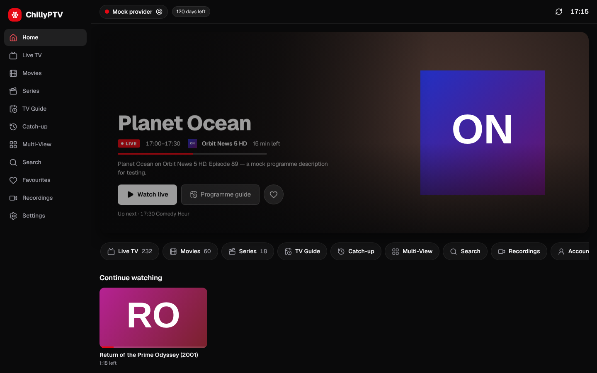
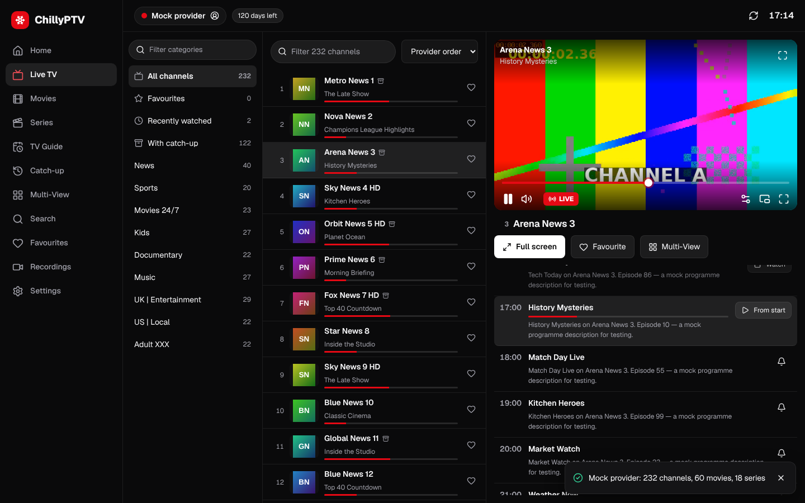
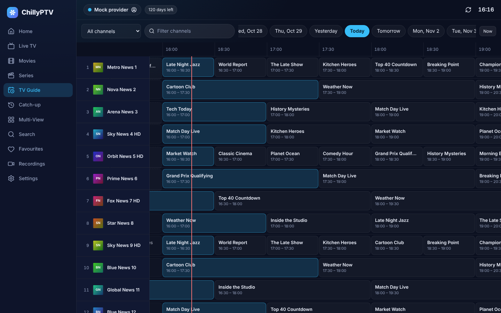
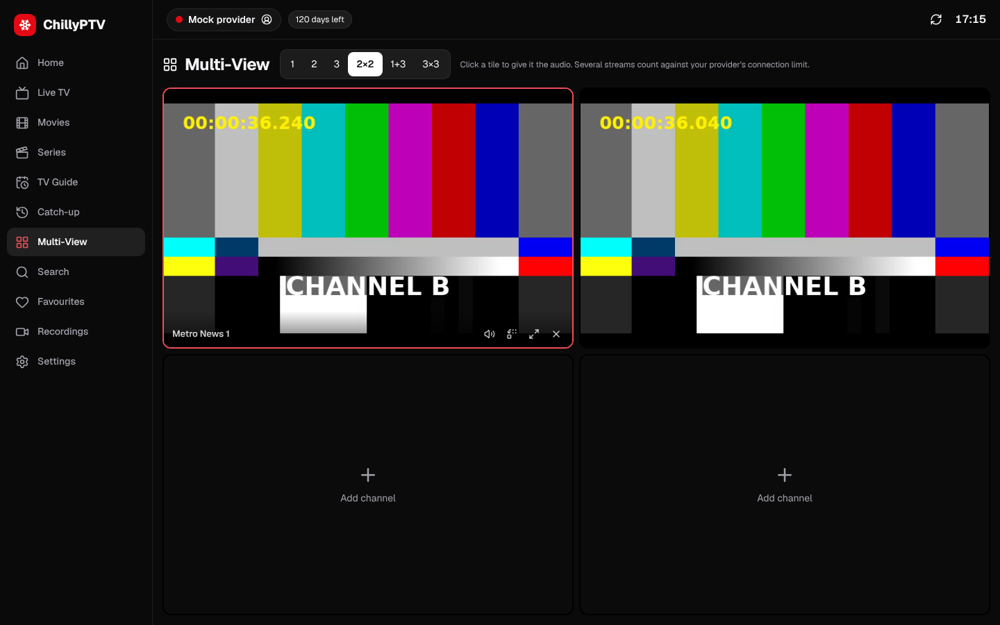
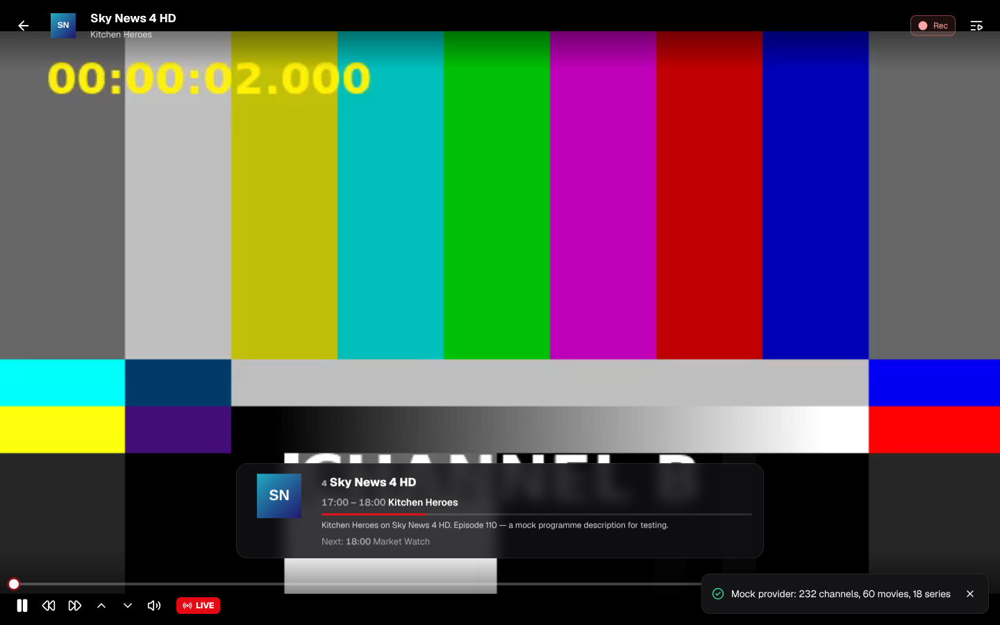
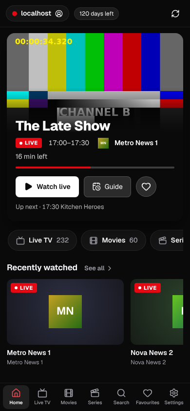

# ❄ ChillyPTV

A modern IPTV player for **Xtream Codes** accounts and **M3U/XMLTV** playlists. It covers what you expect from players like IPTV Smarters Pro (live TV, movies, series, EPG, catch-up, multi-screen, parental control) and adds a lot on top.

It runs as an installable web app (PWA) backed by a small Node server, so it works on desktops, laptops, tablets, phones and TV browsers from a single deployment.

<p align="center"> </p>
<p align="center"> </p>
<p align="center"> </p>

## Features

**The essentials**
- Log in with Xtream Codes (server / user / password), an M3U URL, or an uploaded M3U file. Pasting a `get.php` link fills in the Xtream fields automatically.
- Multiple playlists (profiles) with quick switching.
- Live TV with categories, channel numbers, logos, now-playing info and progress bars.
- Movies and series with posters, ratings, plot, cast, trailers, seasons and episodes.
- EPG from the provider's XMLTV (gzip supported) or the Xtream API, plus a custom XMLTV override per playlist.
- TV catch-up and timeshift (Xtream `timeshift`, plus M3U `catchup="default|append|shift|flussonic|xc"` with `catchup-source` templates).
- Favourites, recently watched, account info (expiry, connections), parental PIN.

**What ChillyPTV adds**
| | |
|---|---|
| **Smart playback engine** | hls.js, mpegts.js, native and server remux behind one player. Falls back automatically (HLS → TS → remux), reconnects live streams with back-off, and has a stall watchdog. |
| **Plays "unplayable" files** | MKV/AVI and AC3/EAC3/DTS audio are remuxed on the fly by ffmpeg (audio → AAC, optional H.264 transcode). Silent playback (unsupported audio) is detected and fixed automatically. |
| **Server-side recordings** | Record now, or schedule from the guide. Recordings run on the server (they continue when the browser is closed) and are converted to seekable MP4 for playback or download. |
| **Sports today** | A Live TV category listing today's football (MLS, Champions League / CONCACAF / Libertadores, Premier League and English cups, LaLiga and Copa del Rey, Liga Profesional and Copa Argentina) with kick-off times, live scores and the channels in *your* guide that show each match. Fixtures come from ESPN's public scoreboards via your server; without it, matches are detected from guide titles. Competitions are chosen in Settings → Sports. |
| **Multi-View** | Up to 9 channels at once (1, 2, 3, 2×2, 1+3, 3×3) with one-click audio focus. |
| **Full TV guide grid** | Virtualised EPG grid across days, with a now-line and actions: watch, *start from the beginning*, catch-up, reminders, recordings. |
| **Search everything** | Fuzzy, typo-tolerant search across channels, movies, series **and the TV guide**, so you can find where a show or match is on. |
| **Reminders** | In-app and desktop notifications with a one-click "Watch" button. |
| **Continue watching** | Resumes movies and episodes, autoplays the next episode with a countdown, tracks per-episode progress. |
| **Live rewind** | Pause and rewind live HLS within the provider's DVR window, then jump back to live. |
| **TV-remote friendly** | Channel up/down, number zapping, previous channel, channel list overlay, and full keyboard control. |
| **Power-user player** | Audio, subtitle and quality tracks; aspect modes (fit/zoom/stretch/16:9/4:3); speed; sleep timer; PiP; live stream statistics; copy URL, open in VLC, or export as `.m3u`. |
| **Category manager** | Hide categories you never watch, and PIN-lock any category (adult categories are locked automatically). |
| **Sync & backup** | Optional sync of playlists, favourites, history and settings between devices through your own server, plus JSON export and import. |
| **Provider quirks handled** | Per-playlist User-Agent, `#EXTVLCOPT`, Kodi `|User-Agent=` headers, redirecting panels, EPG time shift, provider timezones for timeshift. |
| **Themes** | Neutral dark, OLED black and light themes set in Geist, with cinema-red as the signature accent (gold, signal green, ice, violet and platinum available). Responsive down to phone size. |

## Quick start

```bash
npm install
npm run build
npm start               # → http://localhost:8787
```

Or with Docker (ffmpeg included):

```bash
docker compose up -d    # → http://localhost:8787
```

### Development

```bash
npm run dev             # backend on :8787 + Vite on :5173 (with /api proxy)
npm run mock            # optional fake provider on :8788 (user demo / pass demo)
```

The mock provider generates real test streams with ffmpeg: about 230 live channels (HLS and TS), movies (MP4 and an MKV with AC3 audio), series, XMLTV, catch-up and an M3U export. You can develop and test without a real subscription.

## Why there is a server

Browsers cannot talk to most IPTV providers directly: providers serve plain `http://` without CORS headers, and some require a specific User-Agent. The bundled server (zero runtime dependencies, Node ≥ 20) provides:

| Endpoint | Purpose |
|---|---|
| `GET /api/proxy?url=` | Streaming proxy with HLS manifest rewriting, Range support, redirects and custom User-Agent/Referer. |
| `GET /api/remux?url=&start=` | ffmpeg remux/transcode to MPEG-TS (H.264/AAC) for MKV, AVI, HEVC and AC3. |
| `GET /api/epg?url=` | Streams and parses huge XMLTV files server-side, with caching and gzip. The browser receives compact JSON. |
| `/api/recordings` | Recording scheduler (ffmpeg). |
| `/api/state/:key` | Small key/value store for cross-device sync. |
| `GET /api/sports/fixtures?leagues=` | Today's football fixtures, scores and broadcasters (ESPN public scoreboards, cached). |

Without the server (for example as a static site) the app still works for providers that send CORS headers.

### Configuration (environment variables)

| Variable | Default | |
|---|---|---|
| `PORT` / `HOST` | `8787` / `0.0.0.0` | Listen address |
| `CHILLY_PASSWORD` | – | Protects UI and API with HTTP Basic auth |
| `CHILLY_DATA_DIR` | `./data` | Recordings, sync state |
| `CHILLY_USER_AGENT` | desktop Chrome | Default upstream User-Agent |
| `CHILLY_BLOCK_PRIVATE` | – | `1` blocks proxying to private/LAN addresses |
| `CHILLY_EPG_TTL_MIN` | `180` | Server EPG cache lifetime |
| `CHILLY_FFMPEG` | `ffmpeg` | Path to ffmpeg |
| `CHILLY_FIXTURES_BASE` | ESPN soccer API | Alternative fixtures source (ESPN-compatible), e.g. the mock in tests |

> **Security note:** the proxy will fetch any URL it is given. Don't expose the server to the internet without `CHILLY_PASSWORD` (or a reverse proxy with auth).

## Keyboard shortcuts

| Key | Action |
|---|---|
| Space / K | Play / pause |
| ↑ ↓, PgUp PgDn | Channel up / down |
| 0–9 | Jump to channel number |
| Backspace / B | Previous channel |
| C / Enter | Channel list overlay |
| ← → / J L | Seek 10 s / 30 s (rewind live) |
| F, M, P | Fullscreen, mute, picture-in-picture |
| I, S | Programme info, stream statistics |
| N | Next episode |
| Esc | Close player |

## Testing

```bash
npm test                         # unit tests (parsers, catch-up, search, proxy, engine planning)
npm run build && npm run test:e2e   # end-to-end: mock provider + server + Chromium (Playwright)
```

The e2e suite runs 19 scenarios: Xtream login, HLS and MPEG-TS live playback, zapping, number zap, guide, reminders, catch-up, movies with resume, MKV auto-remux, series autoplay, search, multi-view, parental lock, server recording, M3U file playlists and the mobile layout. Screenshots are saved to `test-results/`.

## Project layout

```
server/   Node backend (proxy, remux, EPG, recordings, sync, static hosting)
shared/   M3U + XMLTV parsers (used by server and browser)
src/      React app
  lib/      Xtream client, M3U → catalog, catch-up URLs, search, API client
  store/    zustand stores (profiles, catalog, EPG, library, settings)
  player/   PlaybackEngine + VideoPlayer UI
  pages/    Home, Live TV, Movies, Series, Guide, Catch-up, Multi-View, Search, …
mock/     Mock Xtream provider for dev/e2e
tests/    unit (vitest) and e2e (Playwright)
```

## Legal

ChillyPTV is a player. It does not provide any channels or content. Use it only with playlists and subscriptions you are legally entitled to use.
